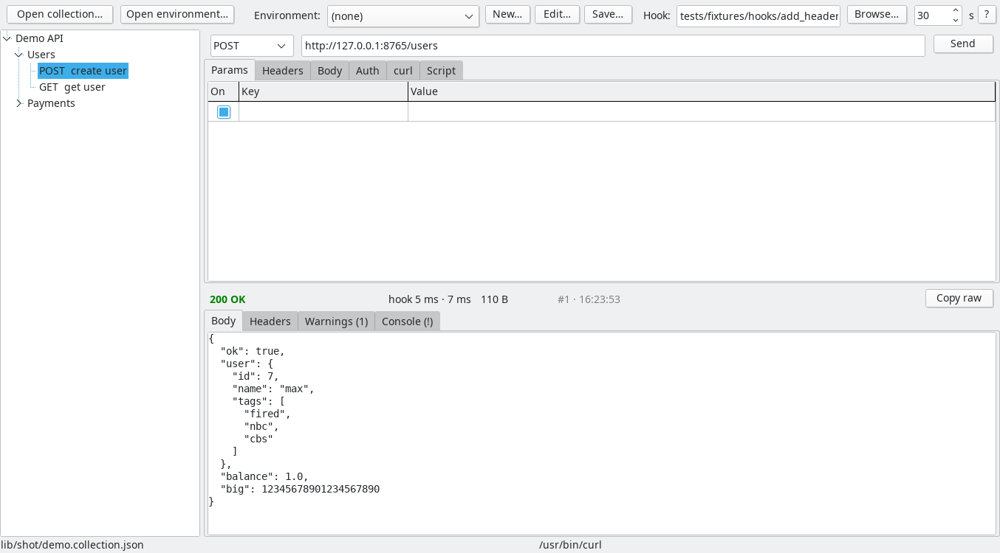

# mailBoy



mailBoy read a comic once. Issue 14, 1987. The courier in it does not
lose the mail. He keeps it. He builds a place on a hill with a gate and
a ledger, and every morning the whole town walks up and gives him their
name, their mother's name and a password with one capital letter, and
he lets them read their own mail through the fence. Later he adds a
workspace. Later he adds a team plan. Later the fence gets a dark mode.
The town pays for the hill.

mailBoy closed the comic and made one decision, which was the whole
decision. Carry the mail to the door. Keep no ledger. Ask nobody's
name. He has been doing it since and nobody has thanked him, which is
how you know it works.

## What it is

A desktop HTTP client. It opens API collection files (v1, v2.0 and
v2.1 exports) and environment files, shows the tree, and fires the
requests through the curl you already have. Linux and Windows.

Written in Lazarus and Free Pascal, so it looks like 1998 and works
like 1998. It does one thing. It has no account, because an account is
a hill. It has no sync, no server, no telemetry and no update check.
Your files stay on your disk, which is where files were invented to
stay. One executable, no runtime, 3.5 MB on disk. 11 MB of RAM on
Windows with a 10,000-line collection open; 35 MB on Linux, where GTK2
brings its own furniture.

- Transport is your `curl`, `wget` if you are that person. mailBoy
  never speaks HTTP itself. The `curl` tab shows the exact command it
  ran, so when it is wrong you can be wrong by hand too.
- `{{variables}}` come from the environment, then the collection. A URL
  that still has one gets refused with the name in red. curl would have
  said "unmatched brace in position 4" and let you find position 4.
- Environments: open one, or press New and get one row per variable
  the collection uses, with "put the host value here" where you have to
  type. A placeholder you forgot counts as undefined. It does not get
  sent to a server as a hostname. We tried that. It was a Tuesday.
- Save writes one JSON file where you point. It is the only file
  mailBoy ever writes. It asks first, like a guest.
- Scripts are not run. They are shown, in a tab, like a photo of a dog
  you used to have.

## The hook

There is no JavaScript engine. There was going to be one. It was going
to take a C library, a compatibility layer for an API nobody fully
documented, and the rest of your life. Instead there is one hook.

Name a program. Any language. mailBoy runs it before each send and
after each response: JSON on stdin, JSON on stdout. It can add headers,
sign the request, grab a token into a variable, check the response.
The request-signing hook that replaced a 60-line pre-request script is
in `examples/hooks/` in Python, Node, bash and Free Pascal, so you can
copy the one in your language and change two steps. In the window a
hook can be attached to the whole collection, a folder or one request.
Nearest wins. No chaining. Chaining is how the hill starts.

A hook is never picked for you, never found on PATH, never named by a
collection file. You name it or nothing runs. A collection somebody
sends you cannot run a program on your machine. That rule has no
exceptions and no settings page.

When the hook fails you get the phase, the command, the exit code, the
whole stderr, the first 500 bytes of whatever it printed instead of
JSON, and the request as it stood. You will know who did it. It will
usually be you. The contract is behind the `?` next to the Hook field,
baked into the binary, because the Windows copy is one `.exe` and nobody
ships the docs. `examples/hooks/README.md` walks through it.

## Command line

Everything the window does, the terminal does, so a script or an agent
can use it without pretending to click.

```
mailBoy                                   open the window
mailBoy <collection.json>                 open the window with that collection
mailBoy --list --collection <file>        request names, one per line
mailBoy --run <request> --collection <file> [--env <file>] [--var name=value]...
        [--json] [--hook <program>] [--timeout <s>] [--no-follow] [--insecure]
```

Exit codes: 0 a response came back, any status, because a 500 is data
and the agent can decide what it means; 1 transport failed; 2 bad input
or a URL variable nothing defined; 3 request not found; 4 no curl, go
install curl; 5 the hook failed. On Windows use `mailboy-cli.exe` from
a shell. `mailboy.exe` is the window, and a window has no stdout, which
Microsoft decided in 1993 and has not revisited.

## Build

```bash
sudo apt install fpc lazarus-ide-gtk2 lcl-gtk2 lcl-utils fp-units-fcl fp-units-base
make build      # -> bin/mailboy, bin/mailboy-cli
make test       # 180 unit tests, smoke tests, hook examples; no display, no network
make release    # optimised, stripped
```

`make release-win64` cross-compiles the Windows executables from Debian
with four packages from the repos; the Makefile header names them.
Fresh unsigned executables get the SmartScreen dialog once. Click
"More info", then "Run anyway". A signing certificate is 400 dollars a
year plus a USB token, which is a hill with a receipt.

## Attribution

GPL-3.0. The files in `samples/collections/` are public Apache-2.0
fixtures from GitHub, not ours; see the README there.
